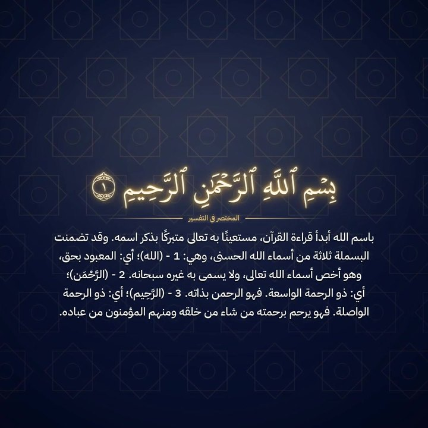
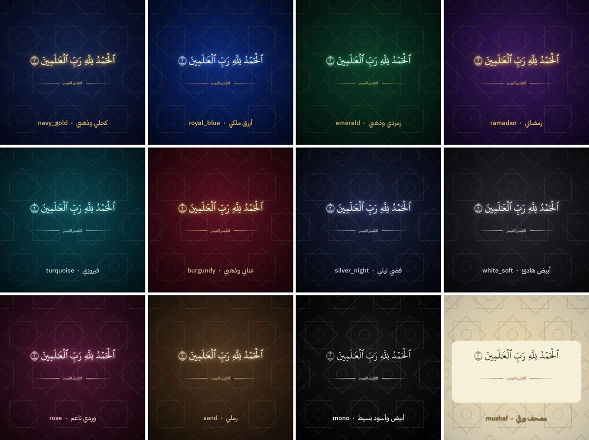

# ✨ كابشن قرآني مضيء

**بلقن (Plugin) لـ Claude يحوّل أي تلاوة إلى ريلز جاهز للنشر**

الآية بالرسم العثماني لمصحف المدينة مع توهج، وتحتها التفسير، ومتزامنة مع نفَس القارئ

## [⬇️ اضغط هنا وحمّل البلقن](https://github.com/aljeerankwq9-hash/quran-glow/raw/main/quran-glow.zip)

`quran-glow.zip` · النسخة 2.0 · 638KB · **مجاني 100%**

---

## ⚠️ قبل لا تبدأ

**لا تفك ضغط الملف ولا تعيد ضغطه.** ارفعه لـ Claude مثل ما نزل بالضبط.

إذا فتحته أو ضغطته من جديد، يطلع لك خطأ `Plugin failed validation` وما يتثبت.

---

## 📥 طريقة التحميل والتثبيت

### من الآيفون
1. اضغط رابط **حمّل البلقن** فوق.
2. يطلع لك سؤال «تنزيل؟»، اضغط **تنزيل**. الملف ينحفظ في تطبيق **الملفات ← التنزيلات**.
3. افتح تطبيق Claude، وروح **Settings ← Plugins ← Upload a plugin**.
4. اختر `quran-glow.zip` من **التنزيلات**، واضغط **Upload**.

### من الكمبيوتر
1. اضغط رابط **حمّل البلقن** فوق، والملف بينزل على طول.
2. افتح [claude.ai](https://claude.ai)، وروح **Settings ← Plugins ← Upload a plugin**.
3. اسحب `quran-glow.zip` للمربع أو اختره، واضغط **Upload**.

### بعد التثبيت
- تأكد إن **السكلات الأربع** مفعّلة (في **Settings ← Skills**).
- تأكد إن **تنفيذ الكود وإنشاء الملفات** مفعّل في إعدادات Claude.
- البلقن ما يطلع في **Connectors**، يطلع في **Plugins**.

---

## 🎬 طريقة الاستخدام

افتح محادثة جديدة، وارفع مقطع التلاوة، واكتب طلبك بكلامك العادي:

> حط الآيات على الفيديو بالخط العثماني مع التفسير الميسر، أبيه ريلز

> هذي تلاوة صوت بس، سوها فيديو ريلز بثيم زمردي وخلفية زخرفة

> رواية ورش، مع المختصر في التفسير، مقاس يوتيوب

> حط اسم حسابي ‎@name، وخل الألوان كحلي وذهبي واحفظها

> عندي ١٠ مقاطع لطلاب الحلقة، سوها كلها

> غيّر الثيم لزمردي وسوي لي معاينة

Claude يطلّع لك **معاينة سريعة** أول، وإذا عجبتك يكمل الفيديو كامل.

---

## 📦 اللي يوصلك

| الملف | شنو هو |
|---|---|
| 🎞️ الفيديو | ريلز 1080×1920، أو مربع، أو يوتيوب 16:9 — تختار اللي تبيه |
| 🖼️ الغلاف | فيه اسم السورة والآيات واسم القارئ |
| 📝 نص المنشور | الآيات والمرجع والتفسير والمصادر والهاشتاقات، جاهز للنسخ |
| 💬 ترجمة SRT | لليوتيوب |
| 📄 ورقة مراجعة PDF | كل مقطع بوقته ونصه وتفسيره، يراجعها المعلم قبل النشر |

---

## 🧩 السكلات الأربع

| السكل | وظيفته |
|---|---|
| `quran-captions` | الأساس: كابشن على فيديو تلاوة |
| `quran-reels` | المقاسات والثيمات والألوان، وتغييرها بدون إعادة الشغل من الصفر |
| `quran-audio-to-video` | تلاوة صوت فقط ← فيديو بخلفية زخرفية متحركة |
| `quran-publish-pack` | الغلاف ونص المنشور وترجمة SRT وورقة المراجعة |

---

## 🎨 الخيارات

**الروايات (٨):** حفص · شعبة · ورش · قالون · الدوري · السوسي · البزي · قنبل

**التفاسير:** التفسير الميسر · المختصر في التفسير · تفسير السعدي

**الترجمات:** الإنجليزية · الإندونيسية · التركية · الفرنسية · الروسية · الفارسية

**الثيمات (١٢)**، وتقدر تحط ألوان هويتك الخاصة:

**خلفيات التلاوة الصوتية:** زخرفة هندسية · نجوم · أضواء · تدرج · قوس

---

## ✅ ليش تثق فيه

- **نص الآيات ما ينكتب باليد.** يتاخذ من بيانات مجمع الملك فهد لطباعة المصحف الشريف بأرقام الكلمات.
- **التفسير ينقل حرفياً** كما هو من مصدره.
- **فحص آلي قبل التسليم:** يقارن كل آية والتفسير بالمصدر كلمة كلمة، ويتأكد من التوقيت وإن النص داخل الإطار.
- **لا رسم للآيات:** الخلفيات زخارف ونجوم وأضواء بس، ما فيها أي صورة تصوّر الآيات ولا ذوات أرواح.

ومع هذا، **راجع ورقة المراجعة قبل النشر.**

---

## ❓ الأسئلة الشائعة

<b>يطلع لي خطأ «Plugin failed validation»</b>

الملف تغيّر قبل الرفع، غالباً انفك ضغطه أو انضغط من جديد. حمّله مرة ثانية من الرابط فوق، وارفعه مثل ما هو بدون ما تفتحه. حجمه الصحيح **638KB**.

<b>أول مرة بطيء</b>

طبيعي. أول تشغيل يجهّز الأدوات وينزّل نص المصحف والخط وموديل التعرّف على الصوت. المرات الجاية أسرع.

<b>كم ياخذ وقت؟</b>

تقريباً ضعفين إلى ثلاث أضعاف مدة المقطع. الأفضل تخلي المقاطع أقل من ٣ دقايق.

<b>ما نزل نص المصحف أو الخط</b>

قل لـ Claude: «شغّل doctor»، وبيقول لك شنو الناقص وشلون تصلحه.

<b>الكابشن يغطي وجه القارئ</b>

قل لـ Claude: «سوه مربع» أو «صغّر الخط».

<b>أقدر أنشر مقاطع مو أنا مصوّرها؟</b>

تأكد من إذن صاحب المقطع قبل ما تنشره، خصوصاً في حساب عليه أرباح.

---

## 📚 المصادر

- **نص المصحف وخط الرسم العثماني:** مجمع الملك فهد لطباعة المصحف الشريف. ما ينضمّون داخل البلقن، وينزلون عند أول استخدام.
- **التفسير الميسر:** مجمع الملك فهد لطباعة المصحف الشريف
- **المختصر في التفسير:** مركز تفسير للدراسات القرآنية
- **تفسير السعدي:** الشيخ عبدالرحمن بن ناصر السعدي
- **خط IBM Plex Sans Arabic:** ترخيص SIL Open Font License

---

**[⬇️ حمّل البلقن](https://github.com/aljeerankwq9-hash/quran-glow/raw/main/quran-glow.zip)**

صنعه أسامة الجيران

